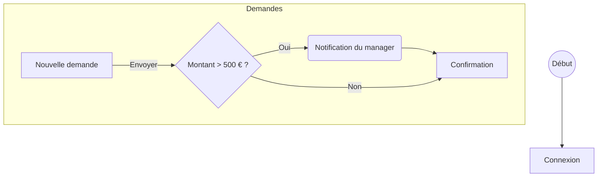

# ProtoLab

ProtoLab transforme les livrables d’un projet en **prototype dynamique** pour les premiers tests utilisateurs, avant le développement :

- le **document de contexte** de SpecGen (Markdown) : son diagramme Mermaid donne l’arborescence et la navigation, son texte les objets métier ;
- les **spécifications** de SpecGen (Markdown) : les règles des champs et l’effet des boutons ;
- la **maquette Figma** (JSON de l’API REST) : l’apparence des écrans, la navigation de Figma ;
- la **bibliothèque du projet** et le **design system global** (composants, variables ou tokens).

Le prototype est un modèle JSON lu par un lecteur unique : les champs se remplissent, les erreurs s’affichent, ce que le participant crée se retrouve sur les écrans suivants. On le **fige** avant une session pour que tous les participants voient la même version, et on l’**exporte** en un fichier HTML autonome.

ProtoLab fait partie de la suite lancée par Studio Dock (SpecGen, AuditErgo, DocAnalyser).

## Ce qui passe par le modèle IA

Seulement des demandes courtes, qui renvoient du JSON vérifié :

| Étape | Sans IA | Avec le modèle |
|---|---|---|
| Structure, modules, navigation | Diagramme Mermaid du contexte | — |
| Écrans | Frames Figma converties (auto-layout → flexbox) | — |
| Rattachement écrans ↔ frames ↔ specs | Par le nom, corrigeable à la main | — |
| Objets métier, données de départ | — | Texte du contexte (une requête) |
| Règles des champs, boutons, listes, textes liés | Navigation Figma et du flow seulement | Un écran à la fois : son plan, sa spec, le flow autour |

Le modèle n’écrit jamais de code : toute proposition qui ne correspond pas à l’écran (calque, écran, champ inconnus) est écartée. Sans connexion au modèle, le prototype garde la navigation.

## Préparer les sources

### Document de contexte (SpecGen)

Le premier bloc ` ```mermaid ` de type `flowchart` placé sous un titre « Structure », « Arborescence », « Flow » ou « Parcours » donne la structure (sinon, le plus grand flowchart). Convention :



- rectangle `[…]` : un **écran** ; losange `{…}` : une **décision** ; arrondi `(…)` : une **action système** ; cercle `((…))` : début ou fin ;
- `subgraph` : un **module** ;
- des **identifiants stables** (`ecran_nouvelle` plutôt que `A`) : les réglages faits dans ProtoLab restent attachés à l’écran quand le contexte est régénéré ;
- `class x,y screen` (ou `:::screen`, `decision`, `action`) force le type d’un nœud.

Un bouton de la maquette sans lien Figma dont le texte est le libellé d’une flèche (« Envoyer ») mène là où le flow l’indique.

### Maquette Figma

Exporter avec le script habituel (proxy de l’entreprise) :

- `GET /v1/files/:key` ou `GET /v1/files/:key/nodes?ids=<page>` ; un node seul est accepté aussi ;
- ajouter `geometry=paths` pour récupérer le tracé des icônes ;
- une **page dédiée aux écrans finaux** (nommée par exemple « Prototype ») : elle est choisie par défaut ;
- des **noms de frames proches des écrans du diagramme** (« 01 - Connexion » ↔ `Connexion`) : le rattachement est automatique.

Les zones sans auto-layout sont affichées à taille fixe et signalées à l’import. Les images sont remplacées par un emplacement gris (le JSON ne contient que leurs références).

### Bibliothèques

Un seul champ d’import, autant de fichiers qu’il faut (un par un, en .zip ou un dossier entier) ; le type de chaque fichier est reconnu au contenu :

- JSON d’un fichier de bibliothèque Figma (composants, variantes, styles de couleur) ;
- variables d’un fichier (`GET /v1/files/:key/variables/local`, offres Enterprise) ;
- fichiers de design tokens (format W3C ou Tokens Studio), par exemple les foundations et un fichier par composant.

Les alias (`"{color.brand.primary}"`) sont résolus d’un fichier à l’autre, et de la bibliothèque projet vers le design system global ; ceux qui ne mènent à aucun token sont signalés. Un fichier réimporté sous le même nom remplace l’ancien ; un composant ou un token présent dans plusieurs fichiers vient du plus récent.

Le **design system global** s’importe une fois (onglet « Design system ») et sert à tous les projets ; chaque projet ajoute sa bibliothèque. Les composants sont retrouvés par leur clé Figma ; les tokens donnent les couleurs des écrans sans maquette et des messages d’erreur.

## Installation et lancement

Prérequis : Python 3.11+, Node.js 20+.

```bash
python -m venv .venv && source .venv/bin/activate   # Windows : install_windows.bat
pip install -r requirements-dev.txt
cd frontend && npm ci && npm run build && cd ..
python backend/launcher.py                          # http://127.0.0.1:8030
```

Sous Windows : `install_windows.bat`, puis `start_app.bat`. L’exe se fabrique avec `build_exe.bat` (ou par la release GitHub).

Sur Mac : `./install_mac.sh`, puis `./start_app_mac.sh` ou double-clic sur `Lancer ProtoLab.command`. Pas à pas : [README_MAC.md](README_MAC.md).

Développement de l’interface : `python backend/launcher.py --no-browser` et `npm run dev` dans `frontend` (5173, relaie `/api` et `/health` vers 8030).

`npm run build` produit aussi le **lecteur autonome** (`frontend/dist-player/protolab-player.js`) inséré dans les exports HTML.

### Connexion au modèle

Écran Paramètres (comme SpecGen) : URL du service compatible OpenAI, clé API (chiffrée avec le compte Windows, ou rangée dans le trousseau sur Mac), certificat de l’entreprise, modèle (`mistral` par défaut). Un fichier `.env` à côté de l’exe est prioritaire (`CUSTOM_API_BASE`, `CUSTOM_API_KEY`, `CUSTOM_CA_BUNDLE`, `CUSTOM_MODEL`, `CUSTOM_TIMEOUT_SECONDS`, `CUSTOM_MAX_OUTPUT_TOKENS`).

### Données

Tout reste sur le poste, dans `%APPDATA%\ProtoLab` (Windows) ou `~/.config/protolab` (Mac) : `projects/<id>/` (sources, réglages, versions figées) et `libraries/global.json`. `PROTOLAB_CONFIG_DIR` change ce dossier.

## Contrat du portail

- port réservé **8030** (SpecGen 8010, DocAnalyser 8020, AuditErgo 8501) ;
- `ProtoLab.exe --port N` : port imposé, sortie code 2 s’il est pris par une autre app ;
- `--no-browser`, `--version` ;
- `GET /health` → `{"status":"ok","app":"protolab","name":"ProtoLab","version":"…"}`, même sans IA configurée.

## Tests

```bash
python -m pytest                         # le modèle n’est jamais appelé (fixture fake_llm)
cd frontend && npx tsc --noEmit -p . && npm run build
```

Les maquettes de test (`tests/fixtures/*.json`) sont produites par `python tests/make_fixtures.py`.

## Versions

Le numéro vit uniquement dans `VERSION`. Publier : `python scripts/bump_version.py patch|minor|major`, fusionner, puis créer la release `vX.Y.Z` sur GitHub : le workflow joint `ProtoLab-X.Y.Z.exe`. Les builds Windows ne tournent que pour les releases (ou à la main).

## Limites de cette première version

- Pas d’édition visuelle : on corrige la mise en page dans Figma et on réimporte.
- Les variantes des composants (état « erreur » d’un champ, case cochée) ne sont pas encore utilisées : le lecteur affiche ses propres états, aux couleurs des tokens.
- Les styles de texte mixtes dans un même calque prennent le style principal.
- Les images ne sont pas récupérées.
