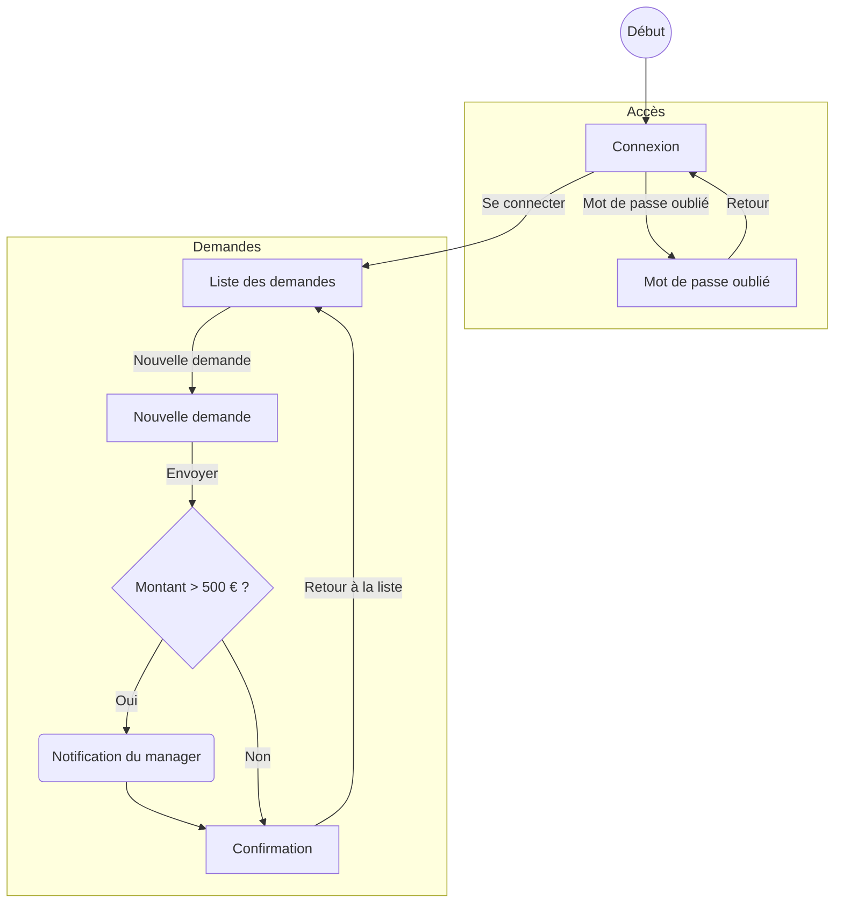

# Portail des demandes

## Contexte métier
Les salariés déposent des demandes d'achat. Une demande a un objet, un montant en euros et un statut
(Brouillon, En attente, Validée, Refusée). Au-delà de 500 €, la demande passe par la validation du manager.

## Profils
- **Demandeur** : crée et suit ses demandes.
- **Manager** : valide les demandes de plus de 500 €.

## Structure de l'app

## Fonctionnalités
Le demandeur voit la liste de ses demandes, en crée une nouvelle et reçoit une confirmation.
